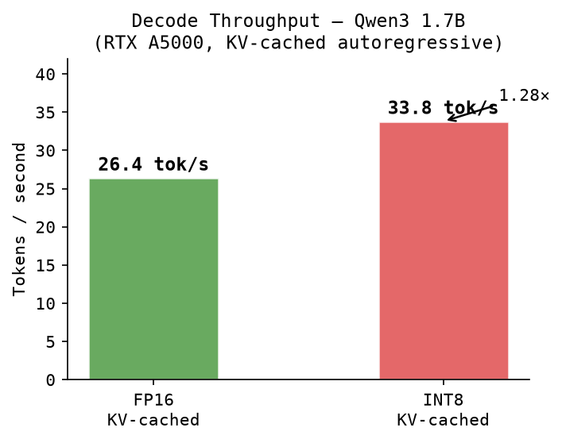
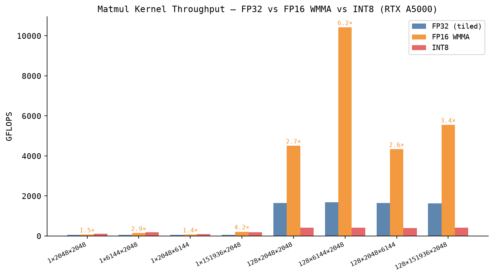
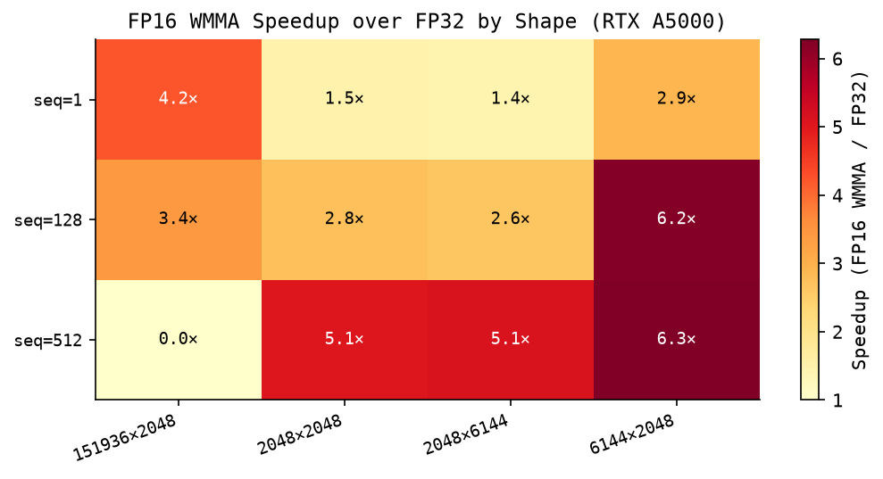
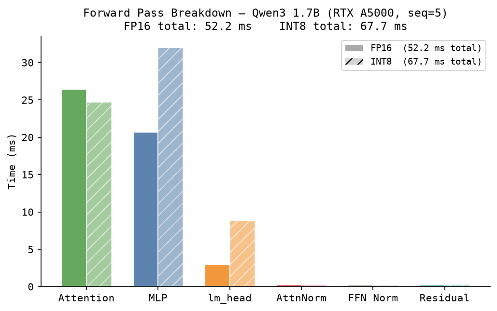

# llm.cu

A from-scratch CUDA inference and LoRA fine-tuning engine for **Qwen3 1.7B** with every kernel written by hand in CUDA.

Benchmarked on **RTX A5000** (24 GB, sm_86, CUDA 12.6.3).

---

## What it does

Runs full Qwen3 1.7B inference end-to-end:

- **FP16 WMMA tensor-core matmul** — up to 6.3× faster than a tiled FP32 baseline
- **KV-cached autoregressive decode** — 26.4 tok/s (FP16), 33.8 tok/s (INT8)
- **INT8 per-channel weight quantization** — halves weight memory (3.44 GB → 1.72 GB)
- **LoRA fine-tuning** — rank-16 adapters on Q/K/V/O, full backward pass, AdamW

Correctness verified layer-by-layer against HuggingFace outputs (59/59 pass).

---

## Performance

### Decode throughput



### Matmul kernel throughput — FP32 vs FP16 WMMA vs INT8



WMMA tensor cores reach **10.4 TFLOPS** on 128×6144×2048 (FFN projection shape at seq=128).

### FP16 WMMA speedup over FP32



### Forward pass kernel breakdown



At seq=5 (prefill), INT8 is *slower* due to dequantization overhead. INT8 wins at decode (seq=1) where the kernel is memory-bandwidth bound and halved weight size matters.

---

## Kernels

**Inference:**
- Embedding lookup
- RMSNorm — parallel reduction in shared memory
- Matrix multiply — FP32 tiled (32×32), FP16 WMMA (tensor cores), INT8 per-channel
- Rotary position embeddings (RoPE, θ=1M)
- Grouped-query attention (16 Q / 8 KV heads, QK-norm, KV cache)
- SwiGLU MLP
- Numerically stable row-wise softmax

**Training (LoRA):**
- LoRA forward: `y += (α/r) * B*(A*x)`
- Fused cross-entropy: softmax + NLL loss + dlogits in one pass
- Backward: RMSNorm, RoPE, SwiGLU, attention, LoRA grad accumulation
- AdamW optimizer
- `matmul_tn` (Aᵀ @ B) for gradient accumulation

---

## Model

Qwen3 1.7B: `hidden=2048`, `layers=28`, `heads=16Q/8KV`, `head_dim=128`, `ffn=6144`, `vocab=151936`.

---

## Build

```bash
mkdir build && cd build
cmake .. -DCMAKE_BUILD_TYPE=Release
make -j$(nproc)
```

Requires CUDA 12+, sm_80+.

## Run

```bash
# Export weights from HuggingFace checkpoint
python python/export_weights.py

# Tokenize a prompt
python python/tokenize_input.py "The capital of France is"

# Verify correctness vs HuggingFace
python python/reference_forward.py
./build/llm_engine
python python/verify.py

# Generate (FP16)
./build/llm_engine --generate --max-tokens 30

# Generate (INT8)
./build/llm_engine --int8 --generate --max-tokens 30

# Decode throughput benchmark
./build/llm_engine --generate --bench-decode 100

# LoRA training
./build/llm_train --lr 1e-4 --steps 100 --seq-len 128 --save-every 50
```
